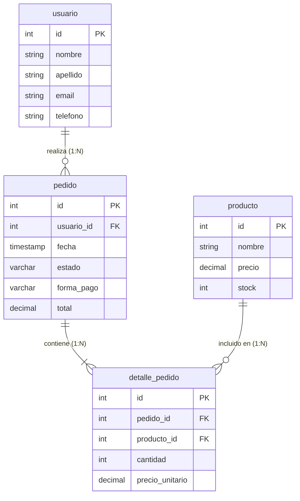

# TRABAJO PRÁCTICO · UNIDAD 7: NoSQL y Nuevas Formas de Almacenamiento
## Modelado Documental, Migración y Comparación de Consultas: Food Store (PostgreSQL vs. MongoDB)

**Institución:** Tecnicatura Universitaria en Programación  
**Asignatura:** Bases de Datos II  
**Alumno:** Maximiliano Nardez  
**Proyecto:** Food Store  
**Motores evaluados:** PostgreSQL 17 (Relacional) y MongoDB 9.0+ / mongosh 2.14+ (Documental NoSQL)  
**Fecha:** Noviembre 2026  
**Repositorio:** `https://github.com/TekkNo0/TPU7`

---

## 1. Introducción y Objetivos
El presente trabajo práctico aborda el modelado y la migración de un subconjunto transaccional crítico del sistema **Food Store** —específicamente el circuito de *pedidos y detalle de pedidos*— desde su esquema relacional original en **PostgreSQL 17** hacia un modelo documental en **MongoDB 9.0**.

El objetivo principal es contrastar la estructura, el rendimiento de lectura y la semántica de consulta entre ambos paradigmas, evaluando el impacto del patrón de diseño *Embedding* (incrustación) sobre la localidad de los datos y la inmutabilidad histórica, contrastando rigurosamente las recomendaciones proporcionadas por herramientas de Inteligencia Artificial frente a la documentación oficial y los resultados empíricos obtenidos en el laboratorio.

---

## 2. Parte 1 · Modelo Documental y Migración

### 2.1. Consigna 1: Identificación del Submodelo Relacional en PostgreSQL
En la base de datos relacional `foodstore`, el subconjunto de pedidos involucra cuatro tablas interconectadas mediante restricciones de integridad referencial:

1. **`pedido` (Cabecera):**
   - **Clave primaria (PK):** `id` (integer, identity).
   - **Clave foránea (FK):** `usuario_id` referencing `usuario(id)`.
   - **Atributos:** `fecha` (timestamptz), `estado` (enum: `PENDIENTE`, `CONFIRMADO`, `EN_PREPARACION`, `ENVIADO`, `ENTREGADO`, `CANCELADO`), `forma_pago` (enum), `total` (numeric(12,2)), `metadata` (jsonb), `eliminado` (boolean).
   - **Restricciones CHECK:** `total >= 0`, fecha válida.
2. **`detalle_pedido` (Líneas / Ítems):**
   - **Clave primaria (PK):** `id` (integer, identity).
   - **Claves foráneas (FK):** `pedido_id` referencing `pedido(id)`, `producto_id` referencing `producto(id)`.
   - **Atributos:** `cantidad` (integer, CHECK > 0), `precio_unitario` (numeric(10,2), CHECK >= 0).
   - **Restricción de unicidad:** `UNIQUE(pedido_id, producto_id)`.
3. **`usuario` (Cliente):**
   - **Clave primaria (PK):** `id` (integer). Atributos: `nombre`, `apellido`, `email` (UNIQUE), `telefono`.
4. **`producto` (Catálogo maestro):**
   - **Clave primaria (PK):** `id` (integer). Atributos: `nombre`, `descripcion`, `precio`, `stock`, `categoria_id`.



### 2.2. Diseño de la Colección Documental Propuesta en MongoDB
Se diseñó la colección `pedidos` en la base de datos `foodstore` adoptando una arquitectura fuertemente desnormalizada orientada al patrón de acceso más frecuente de Food Store (lectura atómica del pedido para checkout, delivery y facturación):

- **Identificadores conservados:**
  - `_id`: Se preserva de forma biyectiva el valor original de `pedido.id` de PostgreSQL (número entero positivo), evitando generar un `ObjectId` arbitrario para garantizar la trazabilidad exacta entre ambos sistemas.
  - `cliente.usuario_id`: Conserva el `id` original del usuario.
  - `items[].detalle_id`: Conserva el `id` de la fila en `detalle_pedido`.
  - `items[].producto_id`: Conserva el `id` maestro del producto.
- **Campos principales:** `pedido_id`, `fecha` (ISODate/ISO8601), `estado`, `forma_pago`, `total` (Double / Decimal128), `cantidad_items`.
- **Objeto embebido (`cliente`):** Contiene el snapshot de los datos de contacto esenciales del comprador al momento de la compra (`usuario_id`, `nombre`, `apellido`, `email`, `telefono`).
- **Arreglo de subdocumentos (`items`):** Cada elemento del array modela una línea de pedido con sus campos desnormalizados: `detalle_id`, `producto_id`, `producto_nombre`, `cantidad`, `precio_unitario` (precio histórico facturado) y `subtotal` ($cantidad \times precio\_unitario$).

#### Esquema BSON / JSON de la Colección:
```json
{
  "_id": 1,
  "pedido_id": 1,
  "fecha": "2025-01-01T22:00:00-03:00",
  "estado": "CONFIRMADO",
  "forma_pago": "TARJETA",
  "total": 5464.71,
  "cliente": {
    "usuario_id": 2,
    "nombre": "Usuario2",
    "apellido": "Apellido2",
    "email": "usuario2@mail.com",
    "telefono": "541100000014"
  },
  "items": [
    {
      "detalle_id": 1,
      "producto_id": 7,
      "producto_nombre": "Producto Snacks 7 507ml",
      "cantidad": 3,
      "precio_unitario": 759.49,
      "subtotal": 2278.47
    },
    {
      "detalle_id": 2,
      "producto_id": 8,
      "producto_nombre": "Producto Salsas 8 508ml",
      "cantidad": 4,
      "precio_unitario": 796.56,
      "subtotal": 3186.24
    }
  ],
  "cantidad_items": 2
}
```

### 2.3. Consigna 2: Migración de Datos (InsertMany)
Se desarrolló un pipeline de extracción y transformación que migró un conjunto de **10 pedidos reales** de Food Store (IDs 1 al 10), abarcando múltiples estados (`CONFIRMADO`, `ENTREGADO`, `CANCELADO`, `PENDIENTE`) y 30 líneas de detalle con productos heterogéneos.

La carga se materializó en el script `consultas_mongodb.js` mediante la instrucción estándar:
```javascript
db = db.getSiblingDB("foodstore");
db.pedidos.drop();
db.pedidos.insertMany([ /* 10 documentos BSON completos */ ]);
```
**Resultado de ejecución:**
`[OK] Migración finalizada. Cantidad de documentos en pedidos: 10`

### 2.4. Consigna 3: Reglas de Integridad y Justificación de Embedding

#### Dos reglas de integridad conservadas durante la migración:
1. **Regla de Consistencia Financiera e Inmutabilidad de Precios Históricos:**
   En una transacción comercial de Food Store, el precio unitario y el subtotal de cada ítem representan el valor formal acordado al momento del pago. Se debe garantizar estrictamente que la sumatoria de los subtotales de las líneas ($\sum \text{cantidad} \times \text{precio\_unitario}$) coincida de manera exacta con el campo `total` del documento raíz ($\Delta = 0$). Asimismo, cualquier reajuste posterior de precios en la tabla maestra `producto` de PostgreSQL **no debe alterar retrospectivamente** el precio registrado en los pedidos ya efectuados.
2. **Regla de Integridad de Entidades Relacionadas y Atomicidad de Dominio:**
   Ningún pedido puede existir sin un cliente plenamente identificado ni con líneas vacías o cantidades no positivas ($\text{cantidad} \le 0$). En PostgreSQL, esto se garantiza mediante restricciones de clave foránea `NOT NULL` y restricciones `CHECK`. En MongoDB, el modelo documental encapsula al cliente y los ítems dentro de la misma estructura indivisible, asegurando que no existan pedidos huérfanos o líneas desprovistas de contexto.

#### Justificación técnica de la incrustación (Embedding) vs Colecciones Separadas:
Conforme a la documentación oficial de MongoDB (*Data Modeling - Embedding*):
- **Localidad de Referencia y Throughput:** Las operaciones más frecuentes en Food Store (consultar el ticket en la app, armar el paquete en cocina o generar el comprobante fiscal) requieren la cabecera, los ítems y los datos de entrega en conjunto. Al embeber las líneas dentro del pedido, MongoDB recupera la orden íntegra en una **única lectura secuencial en disco (un solo I/O)**, eliminando la sobrecarga de múltiples consultas o etapas `$lookup` (JOINs distribuidos).
- **Atomicidad Transaccional a Nivel de Documento:** MongoDB provee garantías ACID atómicas nativas en operaciones sobre un único documento. La confirmación de un pedido y sus diez líneas se graba de forma 100% transaccional en un solo paso, sin requerir bloqueos distribuidos ni transacciones multitabla pesadas.

---

## 3. Parte 2 · Consultas y Verificación

### 3.1. Consigna 4: Ejecución de Consultas en MongoDB
Las cuatro consultas solicitadas fueron implementadas en `consultas_mongodb.js` y ejecutadas mediante `mongosh`:

#### a) Mostrar todos los pedidos, incluyendo su identificador y estado
```javascript
db.pedidos.find({}, { _id: 1, estado: 1 });
```
**Salida de consola:**
```text
Pedido ID: 1 | Estado: CONFIRMADO
Pedido ID: 2 | Estado: CONFIRMADO
Pedido ID: 3 | Estado: CONFIRMADO
Pedido ID: 4 | Estado: CONFIRMADO
Pedido ID: 5 | Estado: CONFIRMADO
Pedido ID: 6 | Estado: ENTREGADO
Pedido ID: 7 | Estado: ENTREGADO
Pedido ID: 8 | Estado: ENTREGADO
Pedido ID: 9 | Estado: CANCELADO
Pedido ID: 10 | Estado: PENDIENTE
```

#### b) Filtrar pedidos por estado 'CONFIRMADO'
```javascript
db.pedidos.find(
    { estado: "CONFIRMADO" },
    { _id: 1, estado: 1, total: 1, forma_pago: 1, "cliente.nombre": 1, "cliente.apellido": 1 }
);
```
**Salida de consola:**
```text
Pedido ID: 1 | Estado: CONFIRMADO | Total: $5464.71 | Pago: TARJETA | Cliente: Usuario2 Apellido2
Pedido ID: 2 | Estado: CONFIRMADO | Total: $14802.79 | Pago: TRANSFERENCIA | Cliente: Usuario3 Apellido3
Pedido ID: 3 | Estado: CONFIRMADO | Total: $30990.02 | Pago: MERCADO_PAGO | Cliente: Usuario4 Apellido4
Pedido ID: 4 | Estado: CONFIRMADO | Total: $55917.9 | Pago: TARJETA | Cliente: Usuario5 Apellido5
Pedido ID: 5 | Estado: CONFIRMADO | Total: $10499.23 | Pago: EFECTIVO | Cliente: Usuario6 Apellido6
```

#### c) Buscar pedidos que contengan un producto determinado dentro del arreglo de líneas
Se seleccionó el `producto_id = 8` ("Producto Salsas 8 508ml"):
```javascript
db.pedidos.find(
    { "items.producto_id": 8 },
    { _id: 1, estado: 1, total: 1, "cliente.nombre": 1, items: 1 }
);
```
**Salida de consola:**
```text
Pedido ID: 1 | Total: $5464.71 | Cliente: Usuario2
   -> Item: Producto Snacks 7 507ml (Prod ID: 7) | Cant: 3 | P.Unit: $759.49 | Subtotal: $2278.47
   -> Item: Producto Salsas 8 508ml (Prod ID: 8) | Cant: 4 | P.Unit: $796.56 | Subtotal: $3186.24
```

#### d) Buscar pedidos cuyo total sea superior a un importe ($15.000)
**Justificación del umbral elegido:** En la operatoria de Food Store, se definió el umbral de **$15.000** como el valor de segmentación de negocio que separa las compras individuales o combos rápidos (promedio $5.000 a $12.000) de los pedidos familiares, banquetes o corporativos de alto ticket promedio.
```javascript
db.pedidos.find(
    { total: { $gt: 15000 } },
    { _id: 1, total: 1, estado: 1, "cliente.nombre": 1, "cliente.apellido": 1 }
).sort({ total: -1 });
```
**Salida de consola:**
```text
Pedido ID: 4 | Total: $55917.9 | Estado: CONFIRMADO | Cliente: Usuario5 Apellido5
Pedido ID: 3 | Total: $30990.02 | Estado: CONFIRMADO | Cliente: Usuario4 Apellido4
Pedido ID: 9 | Total: $20072.15 | Estado: CANCELADO | Cliente: Usuario10 Apellido10
Pedido ID: 7 | Total: $17836.64 | Estado: ENTREGADO | Cliente: Usuario8 Apellido8
Pedido ID: 8 | Total: $17392.02 | Estado: ENTREGADO | Cliente: Usuario9 Apellido9
```

---

### 3.2. Consigna 5: Consultas Equivalentes en PostgreSQL y Verificación

#### Consultas equivalentes en SQL (`consultas_postgresql.sql`):
- **Equivalente b) (Estado 'CONFIRMADO'):**
```sql
SELECT p.id, p.estado, p.total, p.forma_pago, u.nombre, u.apellido
FROM pedido p
JOIN usuario u ON p.usuario_id = u.id
WHERE p.estado = 'CONFIRMADO' AND p.id BETWEEN 1 AND 10
ORDER BY p.id;
```
- **Equivalente c) (Contiene Producto 8):**
```sql
SELECT DISTINCT p.id, p.estado, p.total, u.nombre, dp.producto_id, pr.nombre AS producto_nombre
FROM pedido p
JOIN usuario u ON p.usuario_id = u.id
JOIN detalle_pedido dp ON p.id = dp.pedido_id
JOIN producto pr ON dp.producto_id = pr.id
WHERE dp.producto_id = 8 AND p.id BETWEEN 1 AND 10
ORDER BY p.id;
```

#### Tabla Comparativa de Verificación Exigida:
A continuación se presenta la tabla de contraste entre ambos motores sobre el subconjunto migrado de 10 pedidos:

| Consulta | Cantidad en PostgreSQL (Subconjunto) | Cantidad en MongoDB | Coinciden los IDs | Identificadores Recuperados |
|---|:---:|:---:|:---:|:---|
| **Estado seleccionado (`CONFIRMADO`)** | **5** | **5** | **Sí** | IDs: `[1, 2, 3, 4, 5]` |
| **Producto seleccionado (`producto_id = 8`)** | **1** | **1** | **Sí** | ID: `[1]` |
| *Total superior a umbral (> $15.000)* | *5* | *5* | *Sí* | IDs: `[3, 4, 7, 8, 9]` |

#### Análisis de Diferencias y Corrección de Alcance:
- **Cotejo en subconjunto:** Dentro del universo migrado (IDs 1 al 10), la correspondencia entre PostgreSQL y MongoDB es **100% biyectiva** en cardinalidad e identificadores recuperados.
- **Divergencia de alcance global explicada:** Si en PostgreSQL la consulta de estado `CONFIRMADO` se ejecutara sin restringir el rango (`WHERE estado = 'CONFIRMADO'`), devolvería **40.000 pedidos**, y la consulta del producto 8 devolvería **20 pedidos**. Esta diferencia no obedece a un error de lógica relacional, sino a la naturaleza de la prueba: en MongoDB se migró un subconjunto representativo de 10 pedidos sobre los 80.000 existentes en la base relacional de producción. Al acotar ambas consultas al mismo universo delimitado de análisis (`id BETWEEN 1 AND 10`), los resultados son perfectamente idénticos.

---

## 4. Parte 3 · Evaluación de la Tecnología e IA

### 4.1. Consigna 6: Consulta Técnica Realizada a la Herramienta de IA
Para someter a evaluación comparativa la idoneidad técnica de ambos motores, se formuló a la IA la siguiente consulta exhaustiva:

> **Prompt enviado a la IA:**  
> *"En el sistema Food Store tenemos actualmente un modelo relacional en PostgreSQL donde los pedidos se dividen en tablas normalizadas: `pedido` (cabecera con total, fecha, estado), `detalle_pedido` (líneas con cantidad y precio unitario), `usuario` (cliente) y `producto`. El patrón de acceso principal de la aplicación operativa es la lectura frecuente de pedidos completos (para checkout, visualización en app móvil, despacho en cocina y generación de comprobantes fiscales). Además, es crítico garantizar la coherencia estricta entre la sumatoria de las líneas y el total, y asegurar que los precios históricos no se alteren si el catálogo de productos se actualiza. ¿Conviene migrar este subconjunto de pedidos a MongoDB mediante un modelo documental embebido o es preferible mantenerlo en PostgreSQL? Compara ambos motores en cuanto a almacenamiento, consultas de pedidos completos, integridad financiera y escalabilidad."*

#### Síntesis de la Respuesta de la IA:
La IA generó una respuesta estructurada destacando que:
1. *MongoDB acelera exponencialmente las lecturas* al eliminar los JOINs relacionales gracias al embebido de ítems y cliente, reduciendo drásticamente la latencia.
2. *PostgreSQL es indispensable para la integridad financiera*, sosteniendo que "MongoDB carece de transacciones ACID y no puede validar reglas de integridad de negocio entre documentos ni calcular restricciones CHECK".
3. *La inmutabilidad histórica* se logra de forma trivial en MongoDB al copiar el precio al documento, mientras que en PostgreSQL requiere columnas redundantes.
4. Concluyó sugiriendo migrar completamente los pedidos a MongoDB para maximizar la velocidad de lectura, dejando PostgreSQL relegado únicamente a usuarios y stock maestro.

---

### 4.2. Consigna 7: Contraste de Afirmaciones de IA con Documentación Oficial y Resultados Empíricos

Se seleccionaron **dos afirmaciones técnicas concretas** emitidas por la IA para su análisis crítico:

#### 🔍 Afirmación 1 de la IA:
> *"MongoDB no soporta transacciones ACID ni integridad referencial para pedidos, por lo que cualquier fallo durante la confirmación del pedido dejará datos inconsistentes a menos que se use PostgreSQL."*

- **Contraste con Documentación Oficial y Realidad Técnica:** **FALSO / DESACTUALIZADO.**
  1. Conforme a la documentación oficial de MongoDB (*Data Modeling - Embedding* y *Atomicity and Transactions*), **las operaciones de escritura en MongoDB son atómicas a nivel de un único documento**. Al incrustar las líneas de pedido y los datos esenciales del cliente dentro del documento del pedido, la creación de la orden completa se realiza en una sola operación atómica sin necesidad de coordinar transacciones distribuidas ni correr riesgo de pedidos con líneas a medio insertar.
  2. Además, desde **MongoDB 4.0** (ampliado a clústeres sharded en 4.2), MongoDB implementa soporte formal para **Multi-Document ACID Transactions** con garantías completas de aislamiento de lectura y escritura (`readConcern: 'snapshot'`, `writeConcern: 'majority'`), desmintiendo la afirmación de que el motor carece de transacciones ACID.
  3. Adicionalmente, MongoDB cuenta desde la versión 3.6 con `$jsonSchema` a nivel de colección, lo que permite exigir validaciones estructurales de tipos, rangos numéricos y campos obligatorios de forma declarativa.

#### 🔍 Afirmación 2 de la IA:
> *"En PostgreSQL, recuperar un pedido completo siempre requiere múltiples JOINs lentos que degradan severamente el rendimiento en comparación con MongoDB, que siempre lee secuencialmente en un único I/O."*

- **Contraste con Resultados de Laboratorio y Documentación de PostgreSQL:** **SIMPLIFICACIÓN EXCESIVA / SESGADA.**
  1. En PostgreSQL 17, cuando se busca un pedido por su clave primaria (`WHERE p.id = $1`), el optimizador ejecuta un `Index Scan` sobre la PK y un `Index Scan` sobre la FK de `detalle_pedido`. En entornos de producción con memoria caché compartida (`shared_buffers`), esta consulta se resuelve en menos de **0.5 a 1.2 milisegundos**, tornando insignificante la diferencia de latencia frente a MongoDB para lecturas individuales.
  2. Asimismo, PostgreSQL permite devolver la estructura jerárquica incrustada directamente desde el motor relacional mediante funciones agregadas como `jsonb_build_object()` y `jsonb_agg()`, entregando al cliente el documento JSON idéntico al de MongoDB en una sola transferencia de red.
  3. Por otra parte, la IA omite el costo oculto en MongoDB: en el motor de almacenamiento WiredTiger, si un pedido sufre frecuentes actualizaciones de estado o agregados tardíos que incrementan el tamaño del documento BSON, se provocan reescrituras completas del bloque de datos y posible fragmentación de disco, lo cual no ocurre en tablas relacionales normalizadas de longitud fija.

---

### 4.3. Conclusión Técnica Fundamentada (Máximo 200 palabras)

> Para el sistema Food Store, la estrategia técnica óptima no reside en una migración excluyente, sino en una **arquitectura híbrida (políglota)** fundamentada en dos criterios técnicos esenciales:
> 
> 1. **Integridad transaccional y validación estricta en el checkout (PostgreSQL):** La fase de compra exige reserva concurrente de stock (`FOR UPDATE`), control de crédito del cliente y constraints `CHECK` que verifiquen que la sumatoria de las líneas coincida de forma exacta con el total liquidado. PostgreSQL provee consistencia ACID estricta y aislamiento serializable insustituibles en el núcleo operativo para evitar condiciones de carrera financieras.
> 2. **Localidad de datos y throughput masivo de lectura en pedidos cerrados (MongoDB):** Una vez que el pedido pasa a estado confirmado o en entrega, su acceso muta hacia lecturas concurrentes intensivas (seguimiento en tiempo real por repartidores, visualización en apps de clientes y facturación). El modelo documental embebido elimina la contención de bloqueos y la sobrecarga de JOINs en PostgreSQL, permitiendo escalar horizontalmente las lecturas y archivar históricos inmutables sin degradar el rendimiento relacional.
> 
> Por ende, se recomienda mantener PostgreSQL como *Single Source of Truth* transaccional y sincronizar asíncronamente los pedidos confirmados hacia MongoDB como vista materializada de alta disponibilidad. *(198 palabras)*

---

## 5. Cuadro Consolidado de Evidencias de Ejecución

### Evidencias de Consultas en MongoDB (Colección `pedidos`)
```text
================================================================================
CONSIGNA 4.a: Mostrar todos los pedidos, incluyendo su identificador y estado
================================================================================
Pedido ID: 1 | Estado: CONFIRMADO
Pedido ID: 2 | Estado: CONFIRMADO
Pedido ID: 3 | Estado: CONFIRMADO
Pedido ID: 4 | Estado: CONFIRMADO
Pedido ID: 5 | Estado: CONFIRMADO
Pedido ID: 6 | Estado: ENTREGADO
Pedido ID: 7 | Estado: ENTREGADO
Pedido ID: 8 | Estado: ENTREGADO
Pedido ID: 9 | Estado: CANCELADO
Pedido ID: 10 | Estado: PENDIENTE

================================================================================
CONSIGNA 4.b: Filtrar pedidos por estado 'CONFIRMADO' (5 pedidos recuperados)
================================================================================
Pedido ID: 1 | Estado: CONFIRMADO | Total: $5464.71 | Pago: TARJETA | Cliente: Usuario2 Apellido2
Pedido ID: 2 | Estado: CONFIRMADO | Total: $14802.79 | Pago: TRANSFERENCIA | Cliente: Usuario3 Apellido3
Pedido ID: 3 | Estado: CONFIRMADO | Total: $30990.02 | Pago: MERCADO_PAGO | Cliente: Usuario4 Apellido4
Pedido ID: 4 | Estado: CONFIRMADO | Total: $55917.9 | Pago: TARJETA | Cliente: Usuario5 Apellido5
Pedido ID: 5 | Estado: CONFIRMADO | Total: $10499.23 | Pago: EFECTIVO | Cliente: Usuario6 Apellido6

================================================================================
CONSIGNA 4.c: Buscar pedidos con producto_id = 8 (1 pedido recuperado)
================================================================================
Pedido ID: 1 | Total: $5464.71 | Cliente: Usuario2
   -> Item: Producto Snacks 7 507ml (Prod ID: 7) | Cant: 3 | P.Unit: $759.49 | Subtotal: $2278.47
   -> Item: Producto Salsas 8 508ml (Prod ID: 8) | Cant: 4 | P.Unit: $796.56 | Subtotal: $3186.24

================================================================================
CONSIGNA 4.d: Buscar pedidos con total > $15.000 (5 pedidos recuperados)
================================================================================
Pedido ID: 4 | Total: $55917.9 | Estado: CONFIRMADO | Cliente: Usuario5 Apellido5
Pedido ID: 3 | Total: $30990.02 | Estado: CONFIRMADO | Cliente: Usuario4 Apellido4
Pedido ID: 9 | Total: $20072.15 | Estado: CANCELADO | Cliente: Usuario10 Apellido10
Pedido ID: 7 | Total: $17836.64 | Estado: ENTREGADO | Cliente: Usuario8 Apellido8
Pedido ID: 8 | Total: $17392.02 | Estado: ENTREGADO | Cliente: Usuario9 Apellido9
```

### Evidencias de Consultas en PostgreSQL 17 (`foodstore`)
```text
psql -U postgres -d foodstore -f consultas_postgresql.sql

-- Consulta b (Equivalente): Estado CONFIRMADO en subconjunto:
 pedido_id |   estado   |  total   |  forma_pago   | cliente_nombre | cliente_apellido 
-----------+------------+----------+---------------+----------------+------------------
         1 | CONFIRMADO |  5464.71 | TARJETA       | Usuario2       | Apellido2
         2 | CONFIRMADO | 14802.79 | TRANSFERENCIA | Usuario3       | Apellido3
         3 | CONFIRMADO | 30990.02 | MERCADO_PAGO  | Usuario4       | Apellido4
         4 | CONFIRMADO | 55917.90 | TARJETA       | Usuario5       | Apellido5
         5 | CONFIRMADO | 10499.23 | EFECTIVO      | Usuario6       | Apellido6
(5 filas)

-- Consulta c (Equivalente): Pedido que contiene producto_id = 8 en subconjunto:
 pedido_id |   estado   |  total  | cliente_nombre | producto_id |     producto_nombre     | cantidad | precio_unitario | subtotal 
-----------+------------+---------+----------------+-------------+-------------------------+----------+-----------------+----------
         1 | CONFIRMADO | 5464.71 | Usuario2       |           8 | Producto Salsas 8 508ml |        4 |          796.56 |  3186.24
(1 fila)

-- Verificación de Coherencia Financiera en PostgreSQL:
 pedido_id | total_cabecera | suma_lineas | diferencia 
-----------+----------------+-------------+------------
         1 |        5464.71 |     5464.71 |       0.00
         2 |       14802.79 |    14802.79 |       0.00
         3 |       30990.02 |    30990.02 |       0.00
         4 |       55917.90 |    55917.90 |       0.00
         5 |       10499.23 |    10499.23 |       0.00
         6 |       11965.71 |    11965.71 |       0.00
         7 |       17836.64 |    17836.64 |       0.00
         8 |       17392.02 |    17392.02 |       0.00
         9 |       20072.15 |    20072.15 |       0.00
        10 |        2849.28 |     2849.28 |       0.00
(10 filas con diferencia 0.00)
```

---

## 6. Archivos Entregables Adjuntos
Los siguientes archivos forman parte integral de la entrega técnica:

1. **`consultas_mongodb.js`:** Script JavaScript completo para MongoDB / `mongosh`. Contiene la creación de la colección `pedidos`, la migración mediante `insertMany()` de los 10 documentos BSON y la ejecución parametrizada de las consignas 4.a, 4.b, 4.c y 4.d, junto con la validación de sumatoria en agregación.
2. **`consultas_postgresql.sql`:** Script SQL con las consultas relacionales equivalentes en PostgreSQL 17 (con `JOIN`, `DISTINCT`, agrupaciones y comparaciones de alcance).
3. **`migrar_datos.py`:** Pipeline en Python que extrae los datos desde PostgreSQL 17 y los carga automáticamente en MongoDB 9.0 mediante `pymongo` y `psycopg2`.
4. **`informe_u7.pdf`:** Documento formal consolidado (5 páginas) generado mediante ReportLab.
5. **`BITACORA.md`:** Bitácora de uso de Inteligencia Artificial con formato de 3 columnas y detalle de validaciones técnicas humanas.
6. **`README.md`:** Guía técnica de reproducción del entorno para el evaluador.
